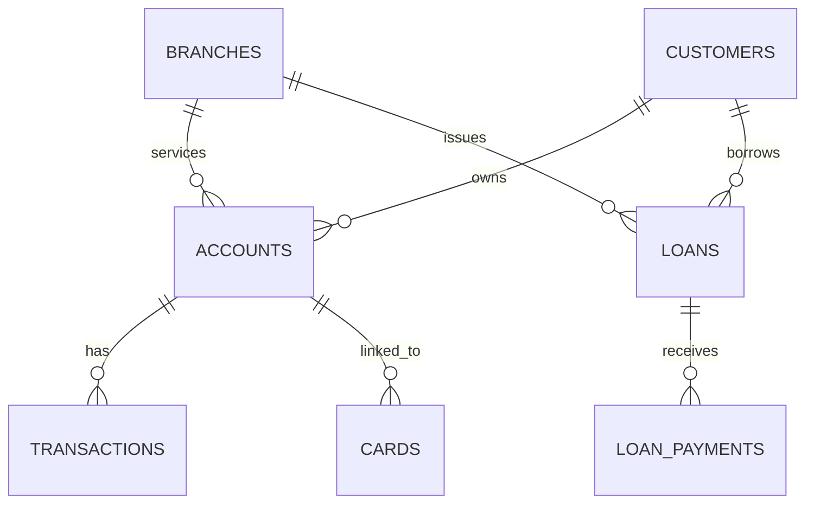

# Retail Banking Transaction Analysis
**Portfolio project | MySQL 8.0 + Python (Pandas) + Streamlit**

## Business problem
Retail banking leadership wants to understand customer segments, account and branch activity, transaction success patterns, loan repayment behaviour, and card engagement. This project follows the supplied six-page project brief and analyzes the supplied CSV dataset.

## Dataset
| Table | Rows | Purpose |
|---|---:|---|
| customers | 500 | Demographics, segment, income, credit score, KYC and activity |
| accounts | 700 | Account type, branch, balances, interest rates and status |
| branches | 40 | Branch location, region and employee count |
| loans | 300 | Loan type, principal, rate, term, status and outstanding balance |
| loan_payments | 2,000 | Scheduled/paid amounts, late days, penalties and payment status |
| cards | 600 | Card type, dates, limits, balance, rewards and activation |
| transactions | 5,000 | Date/time, type, amount, channel, description and status |

The data has no direct customer-to-card relationship: cards link to accounts, and accounts link to customers. Loans link directly to customers and branches. Transactions link to accounts; loan payments link to loans.

## Project structure
```text
Retail_Banking_Transaction_Analysis_Project/
├── app.py
├── requirements.txt
├── README.md
├── data/raw/                 # all seven source CSVs
├── sql/
│   ├── 00_create_schema.sql
│   ├── 01_sprint3_basic_analysis.sql
│   └── 02_objective_analysis.sql
├── python/eda_analysis.py
├── visuals/                  # exported charts + monthly aggregate
└── reports/
    └── Retail_Banking_Transaction_Analysis_Report.docx
```

## How to run the MySQL project
1. Install MySQL Server 8.0+ and MySQL Workbench.
2. Open and execute `sql/00_create_schema.sql`.
3. Import the seven CSVs from `data/raw/` into their same-named tables using Workbench's Table Data Import Wizard. Ensure the first row is treated as column headers and date columns are imported as dates. Import parent tables first: `branches`, `customers`, then `accounts`, `loans`, then `cards`, `transactions`, `loan_payments`. Foreign keys may require loading parent tables first.
4. Run `sql/01_sprint3_basic_analysis.sql`; verify counts against the dataset table above.
5. Run `sql/02_objective_analysis.sql` for the five objective areas.
6. Use the latest `transactions.transaction_date` as the reference date for card expiry and tenure analysis, as required by the brief.

## How to run Python EDA
From the project root:
```bash
python -m pip install -r requirements.txt
python python/eda_analysis.py
```
Charts are saved in `visuals/`. The script prints dataset shape, missing cells, duplicates, key KPIs and foreign-key checks.

## How to run the interactive dashboard
```bash
python -m pip install -r requirements.txt
streamlit run app.py
```
The dashboard includes transaction status, customer segments, monthly completed volume, loan outstanding by status, card activation and loan payment status. Filters are provided for transaction status and type.

## Headline findings from the supplied CSVs
- **5,000 transactions:** 1,688 completed (33.76%), 1,684 pending (33.68%) and 1,628 failed (32.56%). Status proportions warrant operational investigation; do not label pending/failed rows as successful activity.
- **Completed transaction amount:** $10,976,552.36 across completed rows. This is gross completed transaction amount, not net inflow or revenue.
- **Loan portfolio:** 300 loans with $53,441,891.25 outstanding. 169 loans are marked `Defaulted` or `In Arrears` (56.33%).
- **Loan payments:** 968 of 2,000 rows are marked `Late` or `Missed` (48.40%); recorded penalties total $93,961.47.
- **Cards:** only 37 of 600 are marked active (6.17%). 445 have expiry dates before the project reference date of 2025-02-22. Confirm that `is_active` and expiry definitions are consistent before interpreting this as a real operational issue.
- **KYC:** 143 of 500 customers are marked `Verified` (28.60%); review pending, partial and failed statuses.

## Data-quality notes and limitations
- CSVs contain no fully duplicated rows, and all tested foreign-key references point to existing parent records.
- `accounts.close_date` is missing for 497 records. This may be expected for open accounts; validate that closed accounts have close dates and active accounts do not.
- The supplied data appears designed for a training case study. Treat findings as illustrative rather than as claims about an actual bank.
- Transaction amounts have no reliable signed debit/credit convention in the data dictionary. Do not calculate net cash flow from `amount` alone.
- Status values are stored as text. Preserve source labels and map them carefully rather than assuming all statuses have identical definitions.
- For time-based analysis, use `2025-02-22`, the latest transaction date, as the project reference date.

## Recommendations
1. Investigate failed and pending transaction queues by channel, type, time and account; establish SLA and resolution metrics.
2. Segment loans by `loan_status`, payment status, days late and penalties; prioritize a documented collections review workflow.
3. Reconcile card activation flags with expiry dates and product eligibility before drawing conclusions about engagement.
4. Improve KYC completion monitoring and segment the backlog by customer segment and branch.
5. Build a recurring KPI pack with definitions, refresh date, source row counts and quality checks.
6. In a real production environment, enforce least-privilege access and remove or mask direct customer identifiers in exported dashboards.

## ER relationships


## Resume bullet (edit to match your actual contribution)
- Built a retail banking analytics portfolio project using MySQL and Python to model seven relational tables, validate data integrity, analyze 5,000 transactions and 2,000 loan-payment records, and develop business-focused insights into transaction statuses, loan risk, KYC completion and card engagement.


py -3.13 -m venv .venv

.\.venv\Scripts\python.exe -m pip install --upgrade pip


.\.venv\Scripts\python.exe -m pip install -r requirements.txt

.\.venv\Scripts\python.exe -m streamlit run app.py